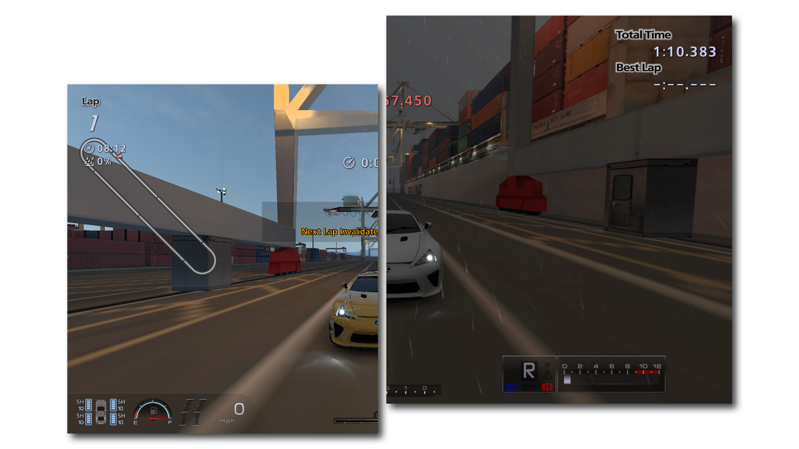

<h4 align="center">rwyMod — A mod that removes all wall collision for tighter lines and out-of-bounds exploration.</h4>

Made for BCUS98114 (GT5 US v2.11) and NPUA81049 (GT6 US v1.05)

⠀
# Requirements
- Writing 0 every frame to the following addresses, use: [knms360's RPCS3 API NetCheat Plugin](https://github.com/knms360/RPCS3-NetCheatAPI)

|Address|Build|
|---|---|
|`423F6558`|GT5 v2.11|
|`423F60F4`|GT5 v2.11|
|`423BE12A`|GT6 v1.05|
|`423BE562`|GT6 v1.05|

⠀
# Installation (build-exclusive.)
- Make sure you're on v2.11 BCUS98114 for GT5 and v1.05 NPUA81049 for GT6.
- Download the mod in the [releases](https://github.com/0x-60/rwyMod/releases/tag/release2) section.
- Open RPCS3, right click on the game, hover over "open folder" and then "open game data folder."
- Drag and drop the pack game files in `/USRDIR/PDIPFS/`

⠀
# Installation (porting)
- Download the mod in the [releases](https://github.com/0x-60/rwyMod/releases/tag/release2) section.
- Unpack your game files with [Nenkai's GTToolsSharp.](https://github.com/Nenkai/GTToolsSharp)
- Drag and drop the modded `".rwy"` files into `"/crs/"`
- Repack your game files using the same program.
- Open Cheat Engine, click Edit > Extra Custom Types > Check All Big Endian Types.
- Once in-game, load into a course and do a new scan for a 2-byte big endian set to 0.
- Drive out of bounds and start scanning for an increased value until reset.
- When back on the course, the reset timer is set to 0, scan for that again.
- Repeat until you find a value that counts upwards to 240-310 ticks.
- Use NetCheat with [knms360's RPCS3 API NetCheat Plugin](https://github.com/knms360/RPCS3-NetCheatAPI).
- Type is `2 (float)` and value is `0` which stops the timer from counting up and resetting you.
